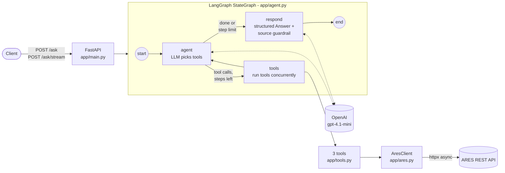

# ARES insight agent

[](https://github.com/aaackoo/ares-insight-agent/actions/workflows/ci.yml)

A small FastAPI service where you ask a natural-language question about a Czech company,
and a LangGraph agent answers it using the public Czech business register
[ARES](https://ares.gov.cz). Every fact in the answer comes with a link to the ARES
record it came from, so a human can verify it.

```bash
curl -s localhost:8000/ask -H 'Content-Type: application/json' \
  -d '{"question": "Is company with IČO 27082440 active, what is its legal form and who are its statutory representatives?"}'
```

```json
{
  "answer": "The company with IČO 27082440, Alza.cz a.s., is active. Its legal form is Akciová společnost (joint-stock company). The statutory representatives are Aleš Zavoral (Chairman of the Board), ...",
  "facts": [
    {
      "statement": "Company with IČO 27082440 is Alza.cz a.s., active, legal form Akciová společnost.",
      "source_url": "https://ares.gov.cz/ekonomicke-subjekty-v-be/rest/ekonomicke-subjekty/27082440"
    },
    {
      "statement": "Statutory representatives of company 27082440 are Aleš Zavoral (Chairman), ...",
      "source_url": "https://ares.gov.cz/ekonomicke-subjekty-v-be/rest/ekonomicke-subjekty-vr/27082440"
    }
  ]
}
```

## Architecture



| File | What it does |
|---|---|
| `app/config.py` | Settings from env vars (pydantic-settings) |
| `app/ares.py` | Async ARES client: company by IČO, search by name, statutory bodies |
| `app/tools.py` | The client wrapped as 3 LangChain tools |
| `app/agent.py` | The graph, the `Answer` model, the LLM factory (OpenAI / Azure OpenAI) |
| `app/main.py` | FastAPI: `POST /ask`, `POST /ask/stream` (SSE), `GET /health` |

## Run locally

Needs Python 3.12 and [uv](https://docs.astral.sh/uv/).

```bash
cp .env.example .env        # then put your OPENAI_API_KEY into .env (it is git-ignored)
uv sync
uv run uvicorn app.main:app --reload
```

Open http://localhost:8000/docs, or stream the agent's steps:

```bash
curl -N localhost:8000/ask/stream -H 'Content-Type: application/json' \
  -d '{"question": "Who runs Kofola ČeskoSlovensko?"}'
```

```
event: tool_call
data: {"tool": "search_companies_by_name", "args": {"name": "Kofola ČeskoSlovensko"}}

event: tool_result
data: {"tool": "search_companies_by_name", "preview": {"total": 1, "items": [{"ico": "24261980", "name": "Kofola ČeskoSlovensko a.s.", "legal_form": "Akciová společnost", ...}]}}

event: tool_call
data: {"tool": "get_statutory_bodies", "args": {"ico": "24261980"}}

event: tool_result
data: {"tool": "get_statutory_bodies", "preview": {"ico": "24261980", "company_name": "Kofola ČeskoSlovensko a.s.", "status": "AKTIVNI", "bodies": [{"body_name": "Statutární orgán - představenstvo", "members": [{"name": "Ing. DANIEL BURYŠ", "role": "místopředseda představenstva", "role_since": "2018-11-30"}, ..., "... 3 more"]}], ...}}

event: answer
data: {"answer": "Kofola ČeskoSlovensko a.s. is run by its statutory board, with Janis Samaras as the chairman, ...", "facts": [{"statement": "Kofola ČeskoSlovensko a.s. has a statutory board with Janis Samaras as chairman since 2015-09-19.", "source_url": "https://ares.gov.cz/ekonomicke-subjekty-v-be/rest/ekonomicke-subjekty-vr/24261980"}, ...]}
```

To use Azure OpenAI instead, set `LLM_PROVIDER=azure` and the `AZURE_OPENAI_*` variables
(see `.env.example`).

## Run in Docker

```bash
docker build -t ares-insight-agent .
docker run --rm --env-file .env -p 8000:8000 ares-insight-agent
```

The key is passed at runtime; `.dockerignore` keeps `.env` out of the image.

## Tests

```bash
uv run pytest                 # 20 tests, no API key or network needed
uv run ruff check . && uv run ruff format --check . && uv run mypy app tests evals
```

- `tests/test_ares.py`: the ARES client against recorded real responses (respx), incl.
  retry, 404, dissolved companies and search results without an IČO.
- `tests/test_agent.py`: the graph with a fake chat model that replays scripted tool
  calls. It checks routing, tool execution, the step limit and the source guardrail.
- `tests/test_api.py`: the endpoints, with the graph dependency overridden.

The fixtures in `tests/fixtures/` are real ARES responses. Home addresses and birth
dates of board members were removed; the client doesn't use them.

## Evals

Unit tests prove the code is wired correctly; they can't tell if a real LLM makes good
decisions. `evals/dataset.jsonl` has 11 questions (English and Czech, by IČO and by
name, a dissolved company, an unknown IČO, an out-of-scope question). For each one it
lists the tools that must be called and the key facts expected in the answer.

```bash
uv run python -m evals.run_eval     # real LLM + real ARES, costs a few cents
```

It prints:
- **tool selection accuracy**: cases where every expected tool was called
- **fact accuracy**: expected facts found in the answer
- **unsupported claims**: claims an LLM judge finds unsupported by the tool results

Latest run (gpt-4.1-mini, November 2026): tool selection 100%, fact accuracy 100% (17/17),
1 unsupported claim. I checked that claim by hand and it is a judge false positive (the
date it doubted is in the ARES data). Two hallucinated source URLs were also removed by
the code guardrail before reaching the answer. Results vary a little between runs.

The evals found real bugs that unit tests didn't:
- ARES returns 404 from the basic endpoint for **dissolved** companies; only the
  commercial register still has them. The agent first said such a company "doesn't exist".
- The commercial register's `datumZapisu` is when an entry was *recorded*, not when a
  person took the role. The agent reported a chairman "since 2026" who has held the role
  since 2022. The client now uses the role start date (`vznikFunkce`).

## Design decisions

**Why an explicit graph instead of `create_react_agent`?** The prebuilt agent hides the
control flow. Here the whole graph is about 50 lines in `build_graph()`: three nodes, one
conditional edge, and a routing function you can read. That made it easy to add the
step limit (a counter in the state, checked in the router, which still produces an
answer instead of raising) and a separate `respond` node for the structured answer.

**Why structured output with sources?** An answer the user can't verify is a liability,
especially about legal facts like who can sign for a company. The final answer is a
Pydantic model where each fact has a `source_url`, so a client can render links and a
human can check each fact in seconds. It is enforced in two layers: the system prompt
forbids facts not returned by a tool, and `drop_unsourced_facts()` removes in code any
fact whose source URL no tool returned during this run. The guardrail checks that the
source exists, not that the statement matches it; the evals measure that.

**Why async here?** The service is almost entirely waiting on I/O: the LLM API and ARES.
With async, one process handles many concurrent requests while they wait, and when
the model asks for several tools at once, they run concurrently (`asyncio.gather`). One
shared `httpx.AsyncClient`, created at startup, reuses connections to ARES. There are no
blocking calls inside the endpoints.

**How SSE helps with long LLM requests.** An agent run takes several seconds (several
LLM calls plus API calls). With plain `/ask` the client waits with no feedback and may
time out. `/ask/stream` sends an event after each graph step (`tool_call`,
`tool_result`, `answer`), so the user sees progress right away. FastAPI's built-in SSE
also sends keep-alive pings, so proxies don't drop a connection that goes quiet during a
slow LLM call. Errors after the stream has started are sent as an `error` event, because
the HTTP status has already been sent.

**What I would add for production:**
- Auth and rate limiting on the endpoints (each request costs LLM money).
- Timeouts and retries on the LLM call, and an overall time limit per request.
- Tracing of each agent run (e.g. LangSmith or OpenTelemetry) and metrics: latency,
  tokens and cost per request, tool error rates.
- A short-lived cache of ARES responses (register data changes slowly).
- Running the evals on a schedule, with a larger dataset and a stronger judge model.
- Statement-level verification: check that each fact's value appears in its source.
